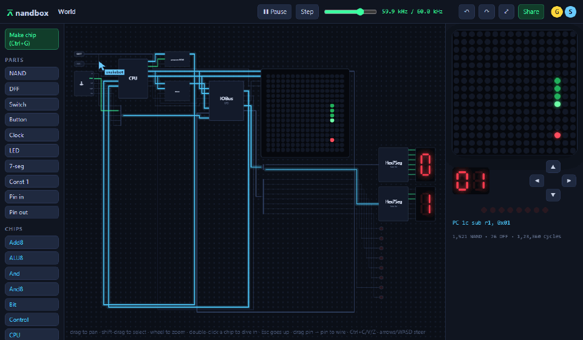
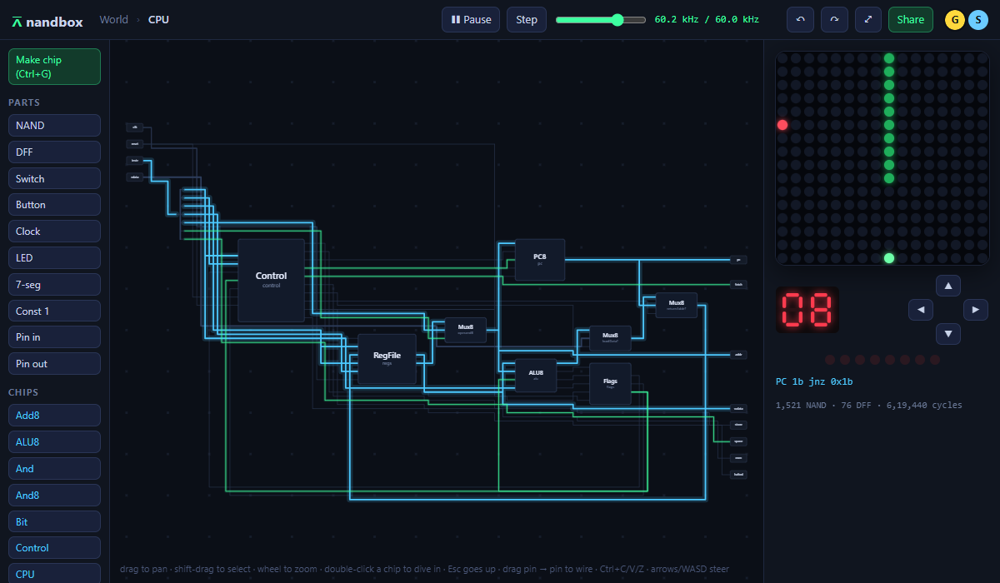
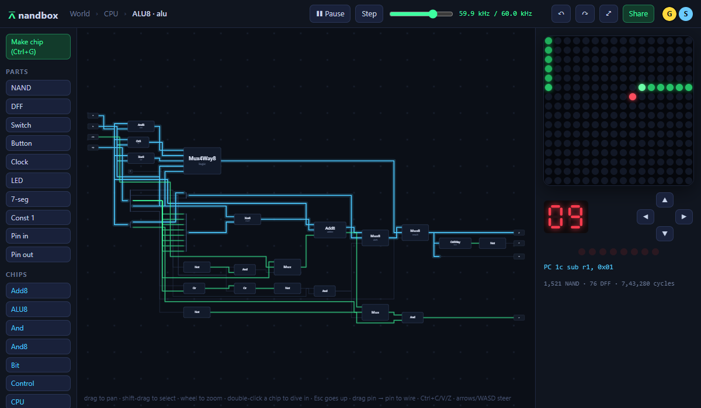
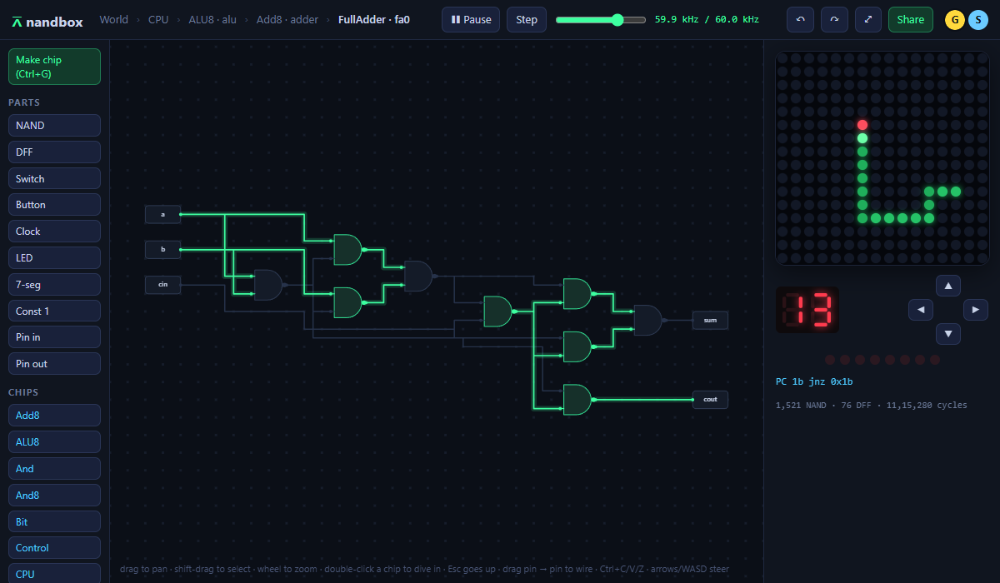
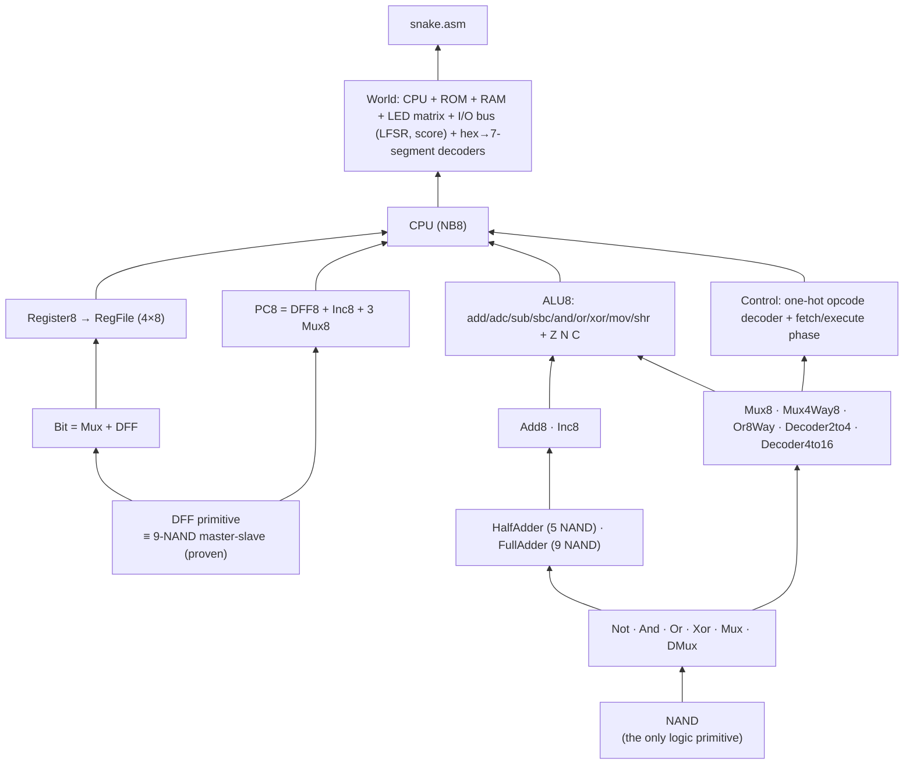
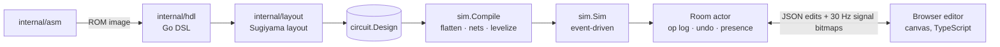

# nandbox

**A multiplayer logic-gate sandbox in your browser where everything is built from NAND gates, including an 8-bit CPU that plays Snake.**

[](https://github.com/aamodbhatt/nandbox/actions/workflows/ci.yml)
[](LICENSE)




<p align="center"><b>1,521 NAND gates · 76 flip-flops · 339 kHz effective CPU clock</b><br>
<sub>Real capture: Snake is being played by a second connected client while the camera dives from the world into the CPU, the ALU, the 8-bit adder and finally the nine NAND gates of one full adder, all glowing live.</sub></p>

| The CPU, as a block diagram | Inside the ALU | Nine NANDs make a full adder |
|---|---|---|
|  |  |  |

## Why

The viral "8-bit CPU built inside Figma" proved people love watching a computer
emerge from simple parts. nandbox takes that further: it is a real simulator, a
real editor and a real toolchain. You can play Snake, then double-click your way
down from the computer to the CPU, the ALU, an adder, a full adder, and the
individual NAND gates, and watch them flip as you steer. Then you can rewire
them, with friends, in the same room.

## What it does

* **Everything from NAND.** Every gate, adder, multiplexer, decoder, the ALU,
  the control unit and the LFSR random generator are NAND networks you can open.
  State is D flip-flops (proven equivalent to the nine-NAND master-slave
  flip-flop) plus RAM/ROM blocks. [Honesty note.](docs/DESIGN.md#honesty-note-what-is-a-primitive)
* **A real 8-bit CPU.** NB8: four registers, 16 opcodes, flags, two-cycle
  fetch/execute, memory-mapped joystick, random source, score display and a
  16×16 LED-matrix framebuffer. [ISA reference.](docs/ISA.md)
* **A toolchain.** A two-pass assembler with labels, constants, expressions,
  data directives and `line:column` errors; Snake, Fibonacci, a counter and a
  scrolling `HELLO NANDBOX` banner, each tested headlessly on the gate-level CPU.
* **A fast simulator.** Flatten, levelize, then evaluate only the gates whose
  inputs changed, using a struct-of-arrays netlist and a bitset dirty set that
  is swept once per settle. Combinational loops are rejected with the exact
  gate path.
* **A multiplayer editor.** Infinite canvas, drag-to-wire with orthogonal
  routing, live signal colouring and bus hex values, drill-down with
  breadcrumbs, a parts palette, marquee select, copy/paste, **turn a selection
  into a new chip** (Ctrl+G) and dive into it, rooms with shareable links,
  named cursors, server-sequenced edits with per-user undo/redo, and
  run/pause/step/speed.
* **One command.** Pure Go (no cgo); the TypeScript editor is bundled with
  esbuild's Go API and embedded with `go:embed`.

## Quickstart

You need [Go 1.27+](https://go.dev/dl/). Nothing else: the browser bundle is
already in the repository.

**Windows (PowerShell)**

```powershell
git clone https://github.com/aamodbhatt/nandbox
cd nandbox
go run ./cmd/nandbox
start http://127.0.0.1:8092
```

**macOS / Linux**

```bash
git clone https://github.com/aamodbhatt/nandbox && cd nandbox
go run ./cmd/nandbox          # then open http://127.0.0.1:8092
```

Opening the page creates a room running Snake and puts its link in the address
bar; share it and everyone lands in the same world. Steer with the arrow keys
or WASD. Double-click any chip to dive in, press Esc or use the breadcrumbs to
come back up. Shift-drag selects, Ctrl+G turns the selection into a chip, and
clicking your avatar (top right) sets your name. Other worlds:
`/?template=hello`, `fib`, `counter` or `blank`.

Flags: `-addr` (default `127.0.0.1:8092`), `-db` (room database, default
`nandbox.db`; empty keeps rooms in memory). Benchmark: `go run ./cmd/nandbox bench`.

## How it works

### From NAND to Snake



### The system



### The clever parts

* **One sweep per settle.** Gates are numbered by logic level, and a gate's
  fanout always sits at a higher level. So the dirty set can be a plain bitset
  swept once from low to high: anything a gate dirties is ahead of the cursor.
  Every gate is evaluated at most once, with no priority queue.
* **Synchronous everything.** Flip-flops and memories sample on clock edges and
  drive "source" signals, so the combinational network is pure NAND and
  levelization is exact. Edges in multiple clock domains are sampled first and
  committed together, so shift registers and ripple counters behave correctly.
* **The DFF proof.** A master-slave flip-flop is nine NANDs with feedback that a
  levelized simulator cannot run, so the DFF is a primitive, and a test drives
  both through all 65,536 sequences of 12 input changes from every start state.
* **A CPU that is easy to watch.** Operand B is simultaneously the ALU input,
  the memory address and the jump target, and the ROM's output register is the
  instruction register, so the datapath is a handful of buses. Loads write back
  during the next fetch, which removes stalls entirely.
* **Machine-made schematics that read well.** Chips are laid out with a compact
  Sugiyama algorithm: DFS back edges become feedback lanes, shared dummy slots
  keep long nets off parts, and channel tracks are assigned with the left-edge
  algorithm. Buses are single wires with a hex value; splitters show the bit
  ranges.
* **Edits survive simulation.** Rewiring recompiles the netlist in
  milliseconds, and flip-flop and memory state is carried over by instance
  path, so Snake keeps running while you edit its CPU.

## Results

Measured with `go run ./cmd/nandbox bench` (Snake with a random-turning
player, 3 s per engine, single core):

| Machine | Engine | CPU clock | Gate evals/s | Evals per cycle |
|---|---|---:|---:|---:|
| Intel Core Ultra 9 275HX laptop, Windows 11 | event-driven | **339 kHz** | 117 M | 346 |
| Intel Core Ultra 9 275HX laptop, Windows 11 | full sweep | 199 kHz | 910 M | 4,563 |
| Shared cloud pod, Xeon Gold 6342 (CPU quota, busy neighbours), Linux | event-driven | 115 kHz | 40 M | 348 |
| Shared cloud pod, Xeon Gold 6342 (CPU quota, busy neighbours), Linux | full sweep | 31 kHz | 142 M | 4,563 |

The target was 50 kHz; on the laptop the event-driven engine runs the CPU about
6.8× faster than that, and even on the contended shared pod it clears it by
2.3×. Event-driven evaluation does 13× less work per cycle than a full sweep;
the sweep's branch-free inner loop is faster per gate, which is why it is only
1.7× behind on the laptop (3.7× on the pod).
`go test -bench Snake ./internal/machine` reports the same metrics (354 kHz and
235 kHz on the laptop). A room runs at 60 kHz by default, where `snake.asm`
moves about 7 cells per second; the speed slider goes from 1 Hz (watch single
edges) to the machine's limit.

The whole computer is **1,521 NAND gates** and **76 flip-flops** (plus a
256-word ROM, 240 bytes of RAM and the 256-pixel screen), **43 logic levels**
deep. A full adder is 9 NANDs, the 8-bit adder 72.

## Testing

`go test ./...` (CI runs it with `-race`):

* **Exhaustive truth tables** for every small chip (Not … Mux8, Add8, Inc8,
  decoders, Hex7Seg), and exact NAND counts for the textbook constructions.
* **ALU property tests** against the Go reference model (`isa.ALU`): all 16
  function codes × both carry-ins × edge operands × 2,000 random pairs, plus a
  Go fuzz target.
* **CPU tests**: one program per opcode and flag case, and a **lockstep
  differential test** running random programs (every 16-bit word is a valid
  instruction) on the gate-level CPU and the reference emulator, comparing
  registers, flags, PC, RAM, video RAM and I/O after every instruction.
* **Programs, headless on the gate-level CPU**: Fibonacci in RAM; the counter
  on the LEDs and score; the banner's framebuffer pixel by pixel; and Snake
  played by a scripted player that eats three pieces of food (checking growth
  and the BCD score), crashes into itself on purpose and restarts.
* **Simulator**: event-driven vs full-sweep equivalence on 400 random circuits
  with DFF feedback and two clock domains (plus a fuzz target), the DFF vs
  NAND master-slave proof, loop and multiple-driver diagnostics, shift
  registers, ripple counters, RAM semantics and state carry-over.
* **Assembler**: every instruction form round-trips through the disassembler;
  labels, constants, expressions and data directives; errors with exact
  `line:column`.
* **Layout**: no overlapping parts and only orthogonal routes in every chip;
  deterministic placement.
* **Server**: op inverses restore designs exactly; invalid batches are
  atomic; a two-client protocol test (sequencing, rejection, per-user
  undo/redo, cursors, viewport subscription and signal frames, speed control);
  a Snake room streams its screen; slow clients are dropped while frames
  coalesce; bbolt persistence round-trips.
* **Web**: `tsc --noEmit` with `strict` and `noUncheckedIndexedAccess`, Biome
  lint and format.
* **Browser smoke test** (`node tools/capture/e2e.mjs` against a running
  server, Edge via Playwright; run locally, not in CI): two users in one room,
  palette, drag-wiring, live values, switch toggling, marquee + copy/paste,
  undo, cursors, and create-chip-from-selection with a dive inside (19 checks).

## Design decisions

The short version (the long one is [docs/DESIGN.md](docs/DESIGN.md)):

* **Zero-delay synchronous simulation**, not timing simulation: it is what makes
  hundreds of kHz possible, and the DFF proof covers the one place feedback
  matters.
* **Buses with splitter taps** so the CPU reads as a block diagram.
* **Server-authoritative op log** instead of a CRDT: one order, validated edits,
  exact inverses for undo; clients are optimistic and resync on rejection.
* **Bounded queues and coalescing frames** so one slow browser cannot slow a
  room or grow memory.
* **The web bundle is committed** (`web/dist`, ~30 KB) so `go run` and
  `go install` need no Node.js; CI rebuilds it with esbuild's Go API and fails
  on any difference.

## Project layout

```
cmd/nandbox/        server and `bench` command
internal/circuit/   document model: chips, parts, wires, shapes, validation
internal/sim/       compiler (flatten, nets, levelize, loop detection) and simulator
internal/hdl/       Go DSL and the chip library up to the CPU and the computer
internal/layout/    layered placement and orthogonal routing for library chips
internal/isa/       NB8 encoding, disassembler, reference emulator
internal/asm/       assembler
internal/machine/   headless computer runner (tests, benchmark)
internal/server/    rooms, op log, presence, streaming, bbolt store
programs/           snake.asm, fib.asm, counter.asm, hello.asm
web/                TypeScript editor (src/), static files, esbuild build, embedded dist/
tools/capture/      Playwright script that recorded the README media
docs/               ISA.md, DESIGN.md, assets/
```

Rebuild the bundle with `go generate ./web`. The README media came from
`node tools/capture/capture.mjs` against a running server (Edge via
Playwright); `node tools/capture/make-gif.mjs` turns the frames into the GIF
(global palette plus inter-frame transparency, 2.2 MB).

## Roadmap

* Probe parts with scrolling waveforms.
* A NAND-latch mode: a unit-delay simulator for circuits with feedback, for
  teaching latches directly.
* A stack and interrupts for NB8, and a larger ROM.
* Offline rooms with replay from the op log.
* Evicting idle rooms from memory (today they stay loaded, with their clock
  stopped, until the server restarts).
* Editing the pins of a chip that is already instantiated (rejected today).
* Rotating parts.

## License

[MIT](LICENSE) © 2026 Aamod Bhatt
