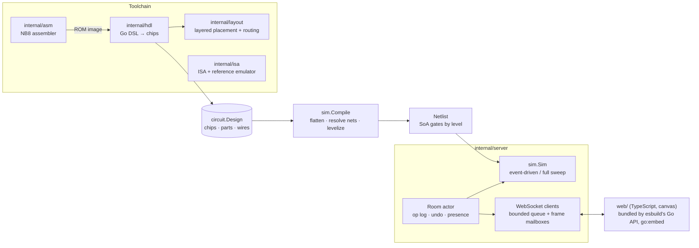

# nandbox design

## Goals

* A CPU you can **watch think**: every gate of a working 8-bit computer is a
  real object in an editor, with live values, while the machine plays Snake.
* **Honest construction**: logic is NAND gates only; state is D flip-flops and
  memories, and the flip-flop primitive is proven equivalent to its NAND form.
* **Fast enough to play**: a gate-level simulation that clocks the CPU well
  above what a playable game needs, on one core.
* **Shared**: a room is a link; everyone in it edits the same circuit and sees
  the same simulation.
* `go run ./cmd/nandbox` is the whole install: pure Go, no cgo, the browser
  bundle embedded.

## Non-goals

* Timing simulation (propagation delays, glitches, metastability). The
  simulator is zero-delay and synchronous by design; see "Trade-offs".
* Tri-state buses, analog behaviour, or multiple drivers per net.
* Scaling to millions of gates or thousands of concurrent rooms.

## Architecture

## Data model (`internal/circuit`)

A `Design` is a set of `ChipDef`s plus a root ("World"). A chip definition
holds `Part`s and `Wire`s. Parts are NAND, DFF, RAM, ROM, LED matrix, I/O
endpoints (clock, switch, button, joystick, LED, seven-segment, constant),
wiring helpers (`in`/`out` interface pins, splitters) and chip instances.

* A chip's interface is the set of `in`/`out` parts inside it, ordered top to
  bottom. Instance pins are named by the **ID** of the interface part, so
  renaming a pin label never breaks a wire.
* Pins carry buses up to 16 bits wide. A splitter maps bus bits to taps
  (`[lo, hi)` ranges); it is pure wiring, so it works in both directions.
* Wires join two pins of equal width. Wires form **nets**: the simulator does
  not care which end is the "from" side; the editor and layout do.

Invariants (`Design.Validate`): every reference resolves, per-kind properties
are in range, wires join existing pins of equal width, and no chip contains
itself. The compiler re-validates before every compile.

## Compiler (`internal/sim/compile.go`)

1. **Flatten.** Instantiate the root recursively. Every pin bit of every part
   instance gets a slot; wires, splitter taps and chip boundaries union slots
   (union-find). Each instance keeps a map from its parts' pins to slots, which
   later becomes the map from what the editor shows to signal indices.
2. **Resolve nets.** Every net needs exactly one driver: a NAND output, a DFF
   or memory output, an I/O source or a constant. A second driver is an error
   naming both parts; an undriven net reads 0.
3. **Number signals densely.** `0` and `1` are the constants, then sources
   (I/O, flip-flops, memory outputs), then gate outputs.
4. **Levelize.** Kahn's algorithm over gate-to-gate edges. Leftover gates
   contain a combinational loop; the compiler walks backwards from one of them
   until it revisits a gate, which yields a concrete cycle, and reports it as a
   path like `World/cpu/u12/g3 -> ... -> back to start`, with locations the
   editor highlights.
5. **Sort gates by level** and lay them out struct-of-arrays: gate `g` reads
   `gateIn[2g]`, `gateIn[2g+1]` and drives signal `gateBase + g`. Fanout is a
   CSR array per signal.
6. **Group sequential elements by clock net** into domains.

## Simulator (`internal/sim/engine.go`)

* Values are one byte per signal; gate evaluation is
  `val[out] = 1 ^ (val[a] & val[b])`.
* **Event-driven settle.** Dirty gates live in a bitset. Because gates are
  sorted by level and a gate's fanout always has a strictly higher level, the
  settle loop can sweep the bitset once, in index order: newly dirtied gates
  are always ahead of the cursor, so every gate is evaluated at most once per
  settle and the result is exactly the levelized fixpoint.
* **Full sweep** evaluates every gate once in level order. It is the reference
  the event-driven mode is checked against (property tests over random
  circuits with feedback through DFFs and multiple clock domains).
* **Clock edges.** After logic settles, every domain whose clock net rose
  samples its inputs; only then do all of them commit, and logic settles again.
  This repeats (bounded) so ripple counters and gated clocks behave like the
  hardware they model. A domain that keeps re-triggering is reported as an
  oscillation instead of hanging.
* **Memories** (RAM, ROM, LED matrix) are synchronous: on the rising edge they
  read (old contents) and then write. Their outputs are sources, so the
  combinational network stays pure NAND.
* **State carry-over.** `Export`/`Import` key flip-flops, inputs and memories
  by their instance path, so recompiling after an edit keeps the running
  program (Snake does not restart when you rewire a gate in a register).
* Deterministic: no maps on hot paths, fixed iteration orders, seeded tests.

## Honesty note: what is a primitive

The **only** things that compute are 2-input NAND gates. Inverters, ANDs,
XORs, multiplexers, adders, the ALU, decoders, the seven-segment decoders and
the LFSR feedback are all NAND networks you can open in the editor.

State is held by three kinds of primitive:

* **D flip-flops.** A textbook positive-edge master-slave flip-flop is nine
  NANDs with two feedback loops, which a levelized simulator cannot evaluate.
  So the DFF is a primitive, and `TestDFFPrimitiveMatchesNandMasterSlave`
  proves it equivalent to the nine-NAND circuit: from each of the 8 start
  states, every sequence of 12 single-input changes (4,096 per start state,
  32,768 sequences), each checked on both engines (65,536 runs) against a
  gate-at-a-time relaxation simulator of the NAND version.
* **RAM and ROM** (and the LED matrix, which is a 256-byte RAM with a display).
  Building 256 bytes of RAM from flip-flops would add ~2,000 flip-flops and a
  large decoder without teaching anything new.
* I/O endpoints (clock, switches, buttons, joystick, LEDs, displays) and
  constants are sources and sinks, not logic.

## The CPU

* Harvard, 8-bit, four registers, 16-bit instructions, fixed two-cycle
  fetch/execute (see [ISA.md](ISA.md)).
* The ROM's registered output *is* the instruction register; ROM enable is the
  fetch phase. Loads write back during the following fetch, so there are no
  stalls and no forwarding.
* Control is a one-hot opcode decoder (`Decoder4to16`), which makes the active
  instruction visible as a single glowing line.
* Size: 1,521 NAND gates and 76 flip-flops for the whole computer (CPU, I/O
  bus with LFSR and score/LED registers, two hex-to-seven-segment decoders),
  43 logic levels deep.

## Layout (`internal/layout`)

Machine-built chips get a compact Sugiyama layout: depth-first back edges
become feedback (they are always register paths in a valid design), layers by
longest path, one shared "dummy" slot per long net and layer so wires never
cross parts, barycenter ordering, y alignment with the driving pins, and
left-edge track assignment in each channel. Feedback nets return along lanes
under the drawing. Tests assert no overlapping parts and orthogonal routes for
every chip. Wires moved by users drop their stored route and are auto-routed
by the editor.

## Server (`internal/server`)

* **Rooms are actors.** One goroutine owns the design, the op log and the
  simulator; clients talk to it through a channel, so there are no locks
  around the hot state.
* **Server-authoritative op log.** Clients apply an edit locally at once
  (optimistic), send it with a client ID, and the server applies it in one
  global order, assigns a sequence number and broadcasts it. The author drops
  its pending copy on the echo; other clients apply it. A rejected edit (it no
  longer applies, e.g. a conflicting concurrent change) makes the author
  reload the server's copy, which is the simple, always-correct recovery.
* **Undo/redo** is per user: applying an op returns its exact inverse
  (removing a part captures its wires), and undo applies that inverse as a new
  sequenced op. Inverses are tested to restore designs byte for byte.
* **Viewport streaming.** Each client subscribes to an instance path and a
  rectangle; the server maps visible wires and pins to signal indices once per
  change and, at 30 Hz, sends a bitmap only when it changed. The dock (screen,
  score, LEDs, PC and instruction) is streamed separately.
* **Back-pressure.** Reliable messages (edits) use a bounded queue per client;
  a client that falls 256 messages behind is disconnected rather than allowed
  to grow memory or slow the room. Frames use single-slot mailboxes that keep
  only the newest frame, so slow clients get fewer frames, never stale ones.
* **Idle rooms stop their clock** when nobody is connected, so a server with
  many rooms only spends CPU on rooms someone is watching.
* **Persistence.** Room snapshots (design + sequence number) are saved to a
  bbolt file every two seconds when dirty and reloaded on demand.

## Failure modes

| Failure | Behaviour |
|---|---|
| Edit creates a combinational loop or a multiply-driven net | edit is kept (it is valid structure), the previous netlist keeps running, every client sees the error and the parts are highlighted |
| Flip-flop clocks itself forever | simulation pauses with an oscillation error |
| Concurrent conflicting edits | the second is rejected; its author resyncs |
| Slow client | frames coalesce; if edits back up, it is disconnected and reconnects |
| Corrupt snapshot on disk | room fails to load with an explicit error |

## Trade-offs and alternatives

* **Zero-delay synchronous vs timing simulation.** Unit-delay or timing-wheel
  simulation would show glitches and allow NAND latches, but every gate could
  then fire many times per cycle and loops need convergence detection. The
  levelized model evaluates each gate at most once per settle, which is what
  makes ~340 kHz possible on a laptop, and the DFF equivalence test covers the one place
  where feedback matters.
* **Event-driven vs full sweep.** On the CPU (laptop numbers), event-driven evaluates about 350
  gates per cycle instead of 4,563 and runs 1.7x faster, even though a full
  sweep is branch-free and reaches ~900 M gate evaluations/s. On very active
  circuits the sweep can win; both are kept and cross-checked.
* **Buses as pins vs bit-level wires.** Bus pins with splitter taps keep the
  CPU block diagram readable (one glowing line with a hex value per bus) at
  the cost of a union-find flattening step.
* **Operation log vs CRDT.** A single authoritative server makes ordering,
  validation (no dangling wires, no recursive chips) and undo simple; CRDTs
  would allow offline editing, which a shared simulation does not need.
* **Committing the web bundle.** `web/dist` is committed so `go run` and
  `go install` work with no Node.js and no generate step; CI regenerates it
  with esbuild's Go API and fails if it differs.
